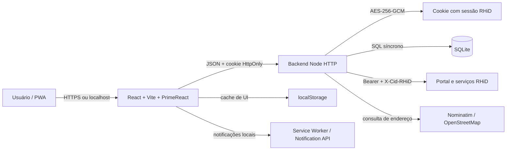
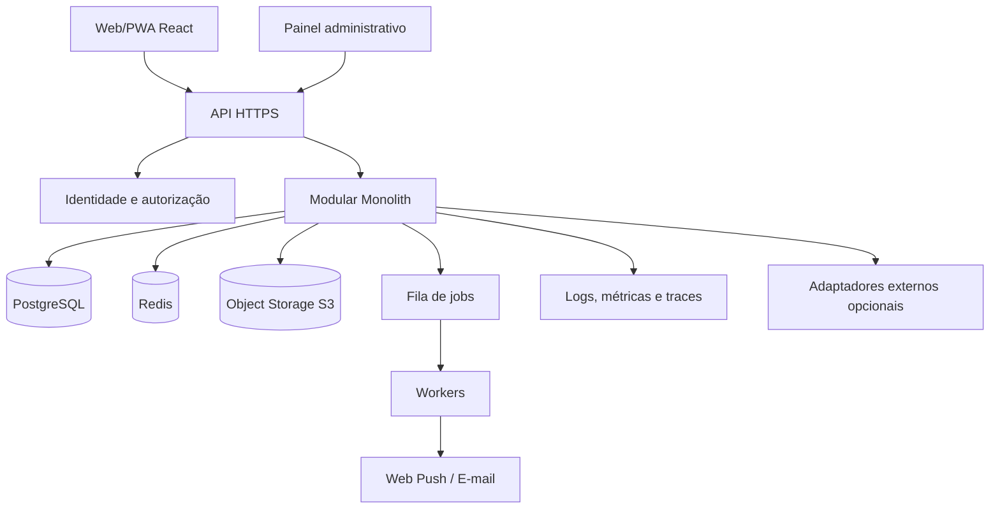

# Gamb RHiD Plus — documentação técnica, auditoria e plano do MVP-2

> Levantamento realizado em 29/07/2026 sobre o código e o runtime disponíveis no repositório. Dados de processo, disco e disponibilidade representam uma fotografia daquele momento; não são limites contratados nem métricas históricas de produção.

## 1. Resumo executivo

O Gamb RHiD Plus atual é uma PWA React que oferece uma interface pessoal para acompanhar jornada, registrar marcações, consultar histórico, criar solicitações e receber alertas. O frontend não acessa o RHiD diretamente: um backend Node autentica no portal, guarda o token em uma sessão criptografada, intermedeia as chamadas e persiste somente dados normalizados em SQLite.

O sistema está funcional, possui testes e proteções importantes contra duplicidade. Entretanto, continua estruturalmente dependente de endpoints e formatos do portal RHiD, inclusive rotas não documentadas no Swagger. A automação de retorno do almoço depende do navegador aberto; não existe worker permanente responsável pela execução.

A auditoria encontrou fallbacks úteis, fallbacks que escondem degradação e dois problemas operacionais prioritários:

1. `official_history_backups` não possui retenção. A tabela contém 1.255 snapshots e ocupa aproximadamente 95,42 MiB de um banco de 95,73 MiB.
2. O modo oficial é habilitado por padrão quando `ALLOW_OFFICIAL_RHID_PUNCH` não é informado. Para uma operação sensível, o comportamento ideal é *fail closed*: envio real somente após configuração explícita.

O MVP-2 proposto neste documento é outro sistema: uma plataforma própria de gestão de jornada, sem o RHiD como fonte de verdade, com identidade, regras, banco, administração, auditoria, notificações e infraestrutura próprios.

## 2. Escopo funcional atual

### 2.1 Autenticação e sessão

- Login com e-mail, senha e domínio/empresa do RHiD.
- Seleção de empresa quando o RHiD retorna mais de um vínculo.
- A senha é usada apenas na chamada de login e não é persistida pelo app.
- O token retornado pelo RHiD é colocado dentro de um cookie de sessão criptografado.
- Consulta de sessão pelo frontend e expiração centralizada quando o upstream retorna falha de autorização.
- Logout limpa o cookie e o estado local relacionado à sessão.
- Limitação de tentativas de login por IP em janela fixa.

### 2.2 Tela inicial

- Resumo da jornada do dia.
- Quatro marcações padrão: Entrada 1, Saída 1, Entrada 2 e Saída 2.
- Exibição de marcações excedentes sem descartá-las do cálculo.
- Tempo trabalhado, intervalo, saldo diário, saldo acumulado e previsão de saída.
- Registro oficial no RHiD com confirmação, geolocalização e conferência posterior.
- Bloqueios de intervalo mínimo, validação após janela intermediária e bloqueio após jornada concluída.
- Atualização manual e automática da situação oficial.
- Resumo da jornada anterior e acesso a solicitações quando há inconsistência.

### 2.3 Retorno automático do almoço

- Monitora jornadas com exatamente duas marcações oficiais.
- Pré-sincroniza aos 58 minutos após a Saída 1.
- Tenta a Entrada 2 automática aos 59 minutos.
- Revalida o dia no RHiD antes de enviar.
- Confirma a marcação consultando novamente o RHiD.
- Valida localização em raio de 100 metros.
- Prioriza as coordenadas das duas primeiras marcações; quando elas não estão disponíveis, usa o perfil de residência ou trabalho salvo em Ajustes.
- O executor está no frontend. Se o navegador, aba, PWA ou processo não estiver ativo, não há garantia de execução.

### 2.4 Registros e banco de horas

- Histórico por data com atalhos de período.
- Ordenação cronológica.
- Filtro para dias com menos de quatro marcações RHiD.
- Tabela com rolagem interna, linhas alternadas e destaque para contagem inferior a quatro.
- Horários, tempo trabalhado, intervalo, saldo e total de marcações oficiais.
- Indicação e detalhamento de pendências retornadas pelo portal.
- Consulta do histórico oficial armazenado e do retorno bruto mantido na sessão.

### 2.5 Solicitações

- Listagem das solicitações pendentes.
- Consulta por período.
- Criação de inclusão de marcação e justificativas permitidas para a conta.
- Confirmação pós-envio pela consulta autenticada do portal.
- Persistência local somente depois da confirmação remota.
- Reenvio de solicitações que estejam explicitamente na fila local.
- Modal restrito aos dados da solicitação selecionada.
- Atalho para preparar comunicação no Outlook após o envio.

### 2.6 Ajustes e localização

- Jornada diária, intervalo e antecedência dos alertas.
- Habilitação/desabilitação padrão do retorno automático.
- Endereços de residência e trabalho.
- Conversão de endereço em coordenadas por geocodificação.
- Captura da geolocalização atual.
- Calendário de dias presenciais.
- Botão de registro que reutiliza o fluxo da tela inicial.

### 2.7 Alertas e PWA

- Alertas de retorno, conclusão, horas extras, marcações ausentes e acompanhamento de solicitações.
- Central de alertas com descarte persistido no navegador.
- Notificação pela API do navegador.
- Service worker com precache dos assets e cache dos tokens visuais.
- PWA instalável.
- Não existe Web Push enviado por backend; notificações agendadas não são garantidas com o app encerrado.

### 2.8 Ferramentas operacionais

- CLI para registrar marcação pela mesma API local.
- Launcher de desenvolvimento.
- Launcher de produção.
- Launcher de teste com envio oficial bloqueado.
- Acesso externo temporário por Cloudflare Tunnel com Basic Auth adicional.
- Scripts de auditoria, reconstrução e congelamento do histórico.

## 3. Arquitetura atual



### 3.1 Frontend

- React 18, TypeScript e Vite.
- PrimeReact, Tailwind CSS e Flaticon UIcons.
- `src/App.tsx` concentra a maior parte da orquestração, estados, efeitos de sincronização e registro.
- `src/components/HistoryView.tsx`, `SettingsView.tsx` e `LoginView.tsx` separam as principais superfícies.
- Regras de jornada ficam em `src/domain/journey.ts`; regras de local e dias úteis ficam em módulos próprios.
- `src/services/rhidApi.ts` é o cliente HTTP do backend.
- `src/services/rhidParser.ts` normaliza formatos heterogêneos devolvidos pelo RHiD.

### 3.2 Backend

- Servidor HTTP nativo do Node, sem Express.
- Arquivo principal: `server/index.mjs`.
- Segurança de origem: `server/requestSecurity.mjs`.
- Cookie: `server/sessionCookie.mjs`.
- Política de marcação: `server/punchPolicy.mjs`.
- Criação/confirmação de solicitações: `server/rhidRequestFlow.mjs` e `server/rhidRequestConfirmation.mjs`.
- Acesso externo e rate limit em memória: `server/externalAccess.mjs`.

O backend expõe, entre outras, as seguintes rotas:

| Grupo | Rotas principais |
| --- | --- |
| Saúde | `GET /api/health` |
| Autenticação | `POST /api/auth/login`, `GET /api/auth/session`, `POST /api/auth/logout` |
| Jornada | `GET /api/rhid/daily`, `GET /api/rhid/history`, `GET /api/rhid/archive`, `GET /api/rhid/apuracao` |
| Marcação | `POST /api/rhid/punch` |
| Pendências | `GET /api/rhid/pending` |
| Solicitações | `GET/POST /api/rhid/requests`, `GET /api/rhid/requests/diagnostics` |
| Perfil | `GET/PUT /api/rhid/location-profile`, `POST /api/rhid/geocode` |
| Apoio | `GET /api/rhid/people` |

### 3.3 Persistência

O SQLite (`better-sqlite3`) mantém:

| Tabela | Responsabilidade | Registros na fotografia |
| --- | --- | ---: |
| `official_archives` | Arquivo oficial normalizado por conta | 1 |
| `official_history_backups` | Snapshots imutáveis do histórico bruto | 1.255 |
| `official_history_freezes` | Período congelado protegido por triggers | 1 |
| `official_submissions` | Último envio aceito para proteção temporal | 1 |
| `official_punch_locations` | Localizações associadas às marcações | 60 |
| `rhid_requests` | Solicitações confirmadas ou fila local | 1 |
| `location_profiles` | Residência, trabalho e agenda presencial | 1 |
| `geocode_cache` | Cache de geocodificação | 0 |

O navegador mantém preferências e cache de renderização em `localStorage`. O SQLite é a persistência operacional do backend, mas o RHiD ainda é a fonte oficial.

## 4. Autenticação em detalhe

1. O frontend envia `email`, `password` e `domain` para `POST /api/auth/login`.
2. O backend limita tentativas por IP e valida tamanho do JSON (máximo de 16 KiB).
3. O backend repassa as credenciais para `https://www.rhid.com.br/v2/login.svc/`.
4. Se houver múltiplas empresas, retorna a lista sem criar sessão; o frontend solicita uma escolha e repete o login.
5. Com sucesso, o backend extrai o token, tipo de acesso, empresa e pessoa.
6. A sessão é serializada e criptografada com AES-256-GCM.
7. O resultado é enviado em `gamb_rhid_session_v2`, com `HttpOnly`, `SameSite=Strict`, `Path=/` e `Secure` em HTTPS.
8. Chamadas seguintes enviam automaticamente o cookie. O backend descriptografa a sessão e injeta `Authorization: Bearer <token>` e, quando aplicável, `X-Cid-RHiD` nas chamadas ao RHiD.
9. A senha não entra na sessão e não é gravada no SQLite.
10. O logout expira o cookie. Falhas de autorização do upstream também podem limpar a sessão.

### Limitações da autenticação atual

- Não existem usuários próprios; identidade, vínculo e disponibilidade dependem do RHiD.
- O cookie carrega o token do upstream, ainda que criptografado.
- O prazo padrão local é de 30 dias; o token do RHiD normalmente expira antes e a aplicação depende do heartbeat/erro para encerrar a sessão.
- O rate limit usa memória do processo; reinicia com o serviço e não funciona de maneira coordenada em múltiplas instâncias.
- Não há MFA, recuperação de senha, gestão de dispositivos ou revogação central própria.

## 5. Envio e recebimento de informações

### 5.1 Leitura

O frontend chama o backend com `fetch`. O backend valida a sessão e consulta o portal:

- `ponto_diario`: marcações do dia;
- `apuracao_ponto_salva_tabela`: histórico e apuração;
- `list_alteracoes_ponto`: pendências e solicitações;
- serviços de tipos de justificativa: opções permitidas para a conta.

O backend recebe texto/JSON, normaliza datas, horários, exclusões, pendências e saldos e devolve JSON sem cache. Dados brutos ficam apenas em memória/resposta da sessão; o SQLite recebe estruturas normalizadas e snapshots específicos.

### 5.2 Marcação

1. O usuário confirma a operação e fornece localização.
2. `POST /api/rhid/punch` valida origem, sessão, feature flag, coordenadas e política temporal.
3. O backend consulta o dia no RHiD antes do envio.
4. Se permitido, envia para `https://repp.rhid.com.br/marcacao_web`.
5. Persiste o horário aceito e a localização.
6. O frontend consulta novamente até a marcação aparecer oficialmente.
7. Enquanto não houver confirmação, não deve repetir o POST.

### 5.3 Solicitação

1. O backend valida tipo, período e justificativa.
2. Inclusão de marcação usa o payload específico da apuração; demais tipos usam o serviço oficial de justificativas.
3. Após o POST, o backend consulta a listagem até quatro vezes, a cada 750 ms.
4. Somente uma solicitação confirmada remotamente é persistida como enviada.
5. A data de abertura é normalizada a partir dos campos efetivos do upstream; não deve ser inferida silenciosamente da data do período.

### 5.4 CORS, CSRF e headers

- GET/HEAD/OPTIONS não passam pelo bloqueio de origem de mutações.
- POST/PUT exigem `Origin` pertencente à mesma origem ou a `TRUSTED_ORIGINS`.
- CORS com credenciais só é devolvido para origem explicitamente confiável.
- O backend define CSP, HSTS em HTTPS, COOP, CORP, Permissions Policy, `nosniff`, `DENY` para frames e `Cache-Control: no-store` na API.
- Na consulta pública de 29/07/2026, o proxy respondeu CSP apenas como `upgrade-insecure-requests`, diferente da política completa definida no Node. Isso deve ser tratado como divergência de produção.

## 6. Execução local

### Requisitos

- Node.js `22.16.0` ou versão compatível com `>=22.12.0`.
- npm; fotografia auditada com npm `10.9.2`.
- Acesso de rede aos serviços do RHiD.

### Desenvolvimento operacional

```bash
npm ci
npm run dev
```

- Frontend: `http://127.0.0.1:5173/gamb_rhid/`.
- Backend: `http://127.0.0.1:8787/api`.
- Atenção: o backend considera o envio oficial habilitado quando a variável de bloqueio não é informada.

### Desenvolvimento seguro sem marcação real

No Git Bash:

```bash
./scripts/dev-test.sh
```

Esse launcher define `ALLOW_OFFICIAL_RHID_PUNCH=false`.

### Produção local

```bash
npm ci
npm run build
npm start
```

O backend serve o `dist/` e a API na mesma origem, normalmente em `http://127.0.0.1:8787/gamb_rhid/`.

### Verificações

```bash
npm run lint
npm test
npm run build
npm audit --audit-level=moderate
```

## 7. Implantação atual

### 7.1 Frontend

- Build Vite com base `/gambrhid/`.
- `VITE_API_BASE=https://gambrhid-api.gamberine.com.br`.
- Upload do conteúdo de `dist/` para `gamberine.com.br/gambrhid/`.
- O script de upload usa autorização temporária da API Hostinger e protocolo TUS; `index.html` é enviado por último.
- A URL pública respondeu HTTP 200 em 29/07/2026.

### 7.2 Backend

- Hospedagem Node da Hostinger.
- Node 22, domínio `gambrhid-api.gamberine.com.br`.
- `server.cjs` adapta a inicialização CommonJS do LiteSpeed ao backend ESM.
- `SERVE_STATIC=false`: o backend publicado expõe a API, enquanto o frontend fica no domínio principal.
- `TRUST_PROXY=true`, `COOKIE_SECURE=true` e origem confiável `https://gamberine.com.br`.
- Dados persistentes fora da pasta pública em `~/domains/gambrhid-api.gamberine.com.br/nodejs-data`.
- O endpoint público `/api/health` respondeu HTTP 200 com `{"ok":true,"externalAccessProtected":false}` em 29/07/2026.

### 7.3 CI/CD

- GitHub Actions executa auditoria, lint, testes e build em push/PR para `main`.
- Dependabot verifica npm e GitHub Actions semanalmente.
- O workflow de GitHub Pages existe, mas depende de `ENABLE_PAGES_DEPLOY=true` e não hospeda o backend funcional.
- O deploy Hostinger observado é assistido por scripts locais; não há, neste repositório, pipeline completo de promoção, rollback e migração do banco para Hostinger.

## 8. Ocupação e consumo

### 8.1 Disco local

| Item | Ocupação aproximada |
| --- | ---: |
| `node_modules` | 301,62 MiB |
| `.data` total | 205,64 MiB |
| SQLite principal | 95,73 MiB |
| 9 backups `.bak` | 101,84 MiB |
| 9 arquivos de log | 8,18 MiB |
| `.git` | 13,19 MiB |
| `dist` | 2,10 MiB |
| `src` | 0,80 MiB |
| `server` | 0,11 MiB |

O banco possui 24.506 páginas de 4 KiB, sem páginas livres na fotografia. A tabela `official_history_backups` usa cerca de 100.057.088 bytes e explica praticamente todo o SQLite.

### 8.2 Bundle

No build auditado:

- JavaScript principal: aproximadamente 449,80 KiB bruto / 131,83 KiB gzip.
- Chunk de Histórico: aproximadamente 275,79 KiB bruto / 75,15 KiB gzip.
- Chunk de Ajustes: aproximadamente 78,58 KiB bruto / 22,79 KiB gzip.
- CSS: aproximadamente 238,61 KiB bruto / 30,47 KiB gzip.
- Fontes locais somam aproximadamente 1,1 MiB.

### 8.3 Processos de desenvolvimento

| Processo | Working set | Memória privada | Observação |
| --- | ---: | ---: | --- |
| API Node (`server/index.mjs`) | 546,98 MiB | 569,30 MiB | Valor alto para o porte do serviço; investigar snapshots/objetos retidos e medir após reinício controlado |
| Vite | 145,63 MiB | 178,73 MiB | Ambiente de desenvolvimento, não representa produção |

O health check local respondeu em aproximadamente 200 ms. Uma única medição não representa latência média nem SLO.

### 8.4 O que ainda não é medido

- CPU, memória e latência históricas em produção.
- Taxa de erro por rota.
- Quantidade de logins, sincronizações, marcações e solicitações por período.
- Crescimento diário do banco.
- Uso de banda e limites do plano Hostinger.
- Disponibilidade mensal e tempo de recuperação.

O MVP-2 deve nascer com métricas, logs estruturados e alertas, em vez de depender de fotografias manuais.

## 9. Validações realizadas

- TypeScript aprovado.
- 98 testes aprovados em 11 arquivos.
- Build Vite aprovado.
- ESLint aprovado sem warnings.
- `npm audit --audit-level=moderate`: 0 vulnerabilidades conhecidas.
- Health local e público: HTTP 200.
- `git diff --check` aprovado antes da criação deste documento.

Essas validações comprovam consistência de código e disponibilidade pontual. Elas não comprovam execução automática quando o navegador está fechado, estabilidade do contrato do RHiD ou capacidade de carga.

## 10. Auditoria de fallbacks

### 10.1 Fallbacks necessários e justificáveis

| Fallback | Motivo | Condição para permanecer |
| --- | --- | --- |
| API relativa quando `VITE_API_BASE` está vazio | Permite mesma origem local/produção | Manter com teste de configuração |
| Geração de `session.key` em `.data` | Facilita execução local sem segredo manual | Em produção exigir volume persistente e segredo gerenciado |
| Buscar `personId` em `ponto_diario` quando ausente na sessão | O login do portal nem sempre devolve o identificador | Registrar a ocorrência e falhar se não houver valor válido |
| Notificação via service worker e, depois, `new Notification` | Compatibilidade entre navegadores | Manter, mas não prometer background confiável |
| Preservar dados fora do período sincronizado | Consultas podem cobrir apenas uma janela | Manter com versionamento e reconciliação explícitos |
| Perfil de localização quando coordenadas das batidas não existem | Contingência operacional validada | Exigir perfil válido e mostrar qual fonte autorizou o envio |
| Aliases de campos do RHiD | O upstream retorna formatos heterogêneos | Isolar no adaptador, validar schema e monitorar campos desconhecidos |
| Cache do service worker para assets/tokens | Operação PWA e resiliência visual | Versionar e invalidar corretamente |

### 10.2 Fallbacks redundantes ou perigosos

| Prioridade | Achado | Risco | Recomendação |
| --- | --- | --- | --- |
| P0 | `ALLOW_OFFICIAL_RHID_PUNCH` assume `true` quando ausente | Envio real pode ser habilitado por erro de configuração | Inverter para `false` por padrão e exigir `true` explícito com confirmação de ambiente |
| P0 | `official_history_backups` sem retenção | Crescimento ilimitado de banco, backup e memória/IO | Reter por janela/quantidade, armazenar deltas ou compactar; executar limpeza transacional auditada |
| P1 | Data de abertura da solicitação pode cair na data inicial do período | Informação semanticamente incorreta apresentada como abertura | Remover o fallback visual; usar `null`, schema explícito e indicador “abertura não retornada pelo RHiD” |
| P1 | `status` desconhecido vira `pending` | Pode representar estado incorreto | Introduzir `unknown` e mostrar origem/diagnóstico |
| P1 | Tipo/descrição ausentes substituem um ao outro | Registros incompletos parecem válidos | Rejeitar ou marcar como payload incompatível |
| P1 | IDs de solicitação podem ser fabricados com tipo/data/descrição | Colisão ou falsa identidade | Usar chave composta versionada e guardar identificador upstream separado |
| P1 | Falha ao consultar solicitações zera a lista no frontend | Erro de rede parece “nenhuma solicitação” | Manter último estado com status `stale` e exibir erro |
| P1 | Saldo acumulado cai silenciosamente para cálculo local | Usuário pode confundir estimativa com saldo oficial | Exibir fonte e nível de confiança; nunca trocar silenciosamente |
| P1 | Perfil de local escolhe residência para todo dia não marcado como presencial | Calendário incompleto pode autorizar referência errada | Exigir tipo de dia explícito ou confirmação quando não houver regra |
| P1 | Perfil corrompido no SQLite vira perfil vazio | Perda lógica fica silenciosa | Alertar, preservar linha para diagnóstico e oferecer recuperação |
| P2 | Muitos `catch` devolvem vazio/null sem telemetria | Dificulta distinguir ausência real de erro | Adotar erros tipados e logs estruturados |
| P2 | `localStorage` é lido com `JSON.parse` sem proteção no hook genérico | Um valor corrompido pode quebrar a inicialização | Validar schema, capturar erro e migrar versão |
| P2 | Rate limits somente em memória | Reinício zera contadores; múltiplas instâncias divergem | Redis ou rate limit no gateway |
| P2 | `server.cjs` e launchers repetem defaults de ambiente | Configuração pode divergir | Schema único de configuração com validação no boot |

### 10.3 Problemas adjacentes encontrados

- `persistPunchLocation()` foi conferido nesta versão: a instrução SQL e a lista de argumentos estão alinhadas. Recomenda-se manter um teste de integração específico para impedir regressões nesse caminho.
- Backups `.bak` e logs somam aproximadamente 110 MiB e não possuem política automatizada de retenção documentada.
- O CSP observado na produção não corresponde ao CSP completo definido no Node; o proxy/hospedagem parece sobrescrevê-lo.
- `src/App.tsx` concentra responsabilidades demais, elevando o risco de efeitos concorrentes e regressões.
- Existe `src/components/bkup_SettingsView.tsx` dentro de `src`; é um backup de código e não deveria permanecer no diretório compilável.
- Scripts de deploy locais referenciam caminhos específicos da máquina e artefatos auxiliares; devem ser substituídos por automação reproduzível.

## 11. Pontos fortes

- Backend protege token e senha do bundle frontend.
- Cookie `HttpOnly`, criptografia autenticada e validação de origem para mutações.
- Confirmação remota após envios sensíveis.
- Regras contra duplicidade no frontend e backend.
- Histórico normalizado, exclusões separadas e proteção de período congelado.
- Testes cobrindo regras críticas de jornada, segurança, cookie, solicitações e retorno automático.
- PWA leve e responsiva.
- Mesma linguagem no frontend e grande parte do backend.
- Deploy frontend/backend separado já operacional.
- Auditoria de dependências sem vulnerabilidades conhecidas no momento.

## 12. Fraquezas e dívida técnica

- Dependência de rotas e formatos do portal RHiD sem contrato estável.
- O RHiD é simultaneamente provedor de identidade, regras e dados.
- Automação crítica executada pelo navegador.
- SQLite síncrono e processo único limitam escala e alta disponibilidade.
- Sem migrações versionadas do banco (`user_version` está em 0).
- Sem observabilidade estruturada, traces, métricas ou SLO.
- Retenção de snapshots ilimitada.
- Sem gestão própria de usuários, papéis, empresas e políticas.
- Sem fila durável para jobs, notificações e reconciliação.
- Sem Web Push verdadeiro.
- Fallbacks silenciosos podem apresentar dados estimados como oficiais.
- Deploy Hostinger assistido, sem rollback automatizado e sem evidência de restauração periódica.
- Sessão e rate limit não são adequados para múltiplas instâncias.

---

# Parte II — Plano do MVP-2 independente

## 13. Visão do produto

O MVP-2 será uma plataforma própria de gestão de jornada. O RHiD deixa de existir no núcleo: marcações, usuários, regras, aprovações, banco de horas, auditoria e relatórios passam a pertencer ao novo sistema.

A analogia com WordPress serve somente como modelo mental:

- um núcleo instalável e versionado;
- um painel administrativo geral;
- organizações configuráveis;
- papéis e permissões;
- definições próprias sem editar código;
- módulos desacoplados e integrações opcionais por adaptadores.

Não se propõe reutilizar WordPress, PHP ou seu banco. A proposta é um produto de jornada com experiência administrativa semelhante em autonomia e configuração.

## 14. Princípios do MVP-2

1. Fonte de verdade própria.
2. Regras versionadas e auditáveis.
3. Segurança e privacidade por padrão.
4. Operações sensíveis em modo *fail closed*.
5. Frontend sem segredos e sem regras autoritativas.
6. Backend modular antes de microserviços.
7. Banco relacional com migrações.
8. Jobs críticos executados no servidor.
9. Toda alteração relevante gera auditoria imutável.
10. APIs documentadas e contratos validados.
11. Observabilidade desde a primeira versão.
12. Integrações externas opcionais e isoladas do domínio.

## 15. Perfis e controle de acesso

| Papel | Responsabilidades |
| --- | --- |
| Superadministrador | Instâncias, organizações, planos, segurança, suporte e auditoria global |
| Administrador da organização | Usuários, unidades, políticas, calendários e integrações da organização |
| RH/DP | Contratos, escalas, ajustes, fechamento, banco de horas e relatórios |
| Gestor | Equipe, aprovação de solicitações e acompanhamento de exceções |
| Colaborador | Marcação, jornada, solicitações, documentos e preferências |
| Auditor | Leitura de eventos, regras, aprovações e relatórios autorizados |
| Integração | Credencial técnica limitada a escopos de API |

O RBAC deve aceitar escopo por organização, unidade, equipe e próprio usuário. A autorização deve ser testada no serviço e, quando possível, reforçada por Row-Level Security no PostgreSQL.

## 16. Módulos funcionais

### 16.1 Núcleo administrativo

- Organizações, unidades, departamentos, equipes e centros de custo.
- Usuários, convites, bloqueios, sessões e dispositivos.
- Papéis, permissões e escopos.
- Configurações globais e por organização.
- Branding, domínio, idioma, fuso e políticas de retenção.

### 16.2 Cadastro laboral

- Perfil do colaborador.
- Contrato, carga horária, vigência e gestor.
- Escalas fixas, flexíveis, turnos e plantões.
- Feriados nacionais, estaduais, municipais e personalizados.
- Trabalho presencial, remoto e híbrido.

### 16.3 Marcações

- Entrada/saída web e PWA.
- Dispositivo, IP, localização, precisão e origem.
- Idempotência e proteção contra duplicidade.
- Políticas de geofence configuráveis.
- Operação offline com fila assinada e reconciliação controlada.
- Importação por arquivo e API opcional.

### 16.4 Motor de jornada

- Pares de entrada/saída.
- Intervalos obrigatórios e flexíveis.
- Tolerâncias, atrasos, faltas e horas extras.
- Adicional noturno e virada de dia.
- Banco de horas e períodos de compensação.
- Regras versionadas por vigência.
- Reprocessamento determinístico com trilha de auditoria.

### 16.5 Solicitações e aprovações

- Inclusão/edição de marcação.
- Justificativa, atestado, ausência, folga e compensação.
- Anexos com antivírus e política de retenção.
- Workflows configuráveis por tipo, equipe e valor de impacto.
- Comentários, devolução, aprovação, recusa e delegação.
- SLA e escalonamento.

### 16.6 Comunicação

- Central de alertas.
- E-mail transacional.
- Web Push.
- Templates por organização.
- Preferências, silêncio, lembretes e escalonamento.
- Fila durável e registro de entrega.

### 16.7 Relatórios e auditoria

- Espelho de ponto.
- Fechamento mensal.
- Banco de horas.
- Exceções e pendências.
- Exportação CSV/PDF.
- Eventos de segurança e alterações administrativas.
- Auditoria append-only com ator, contexto, antes/depois e correlação.

### 16.8 Integrações

- API pública versionada.
- Webhooks assinados.
- Adaptadores opcionais para folha, ERP, diretórios e importadores.
- Um adaptador RHiD futuro, se desejado, deve ser periférico; nunca fonte obrigatória do núcleo.

## 17. Arquitetura proposta



### 17.1 Stack recomendada

| Camada | Escolha inicial | Motivo |
| --- | --- | --- |
| Frontend | React + TypeScript + Vite/PWA | Continuidade técnica e bundle separado |
| Backend | TypeScript + Fastify ou NestJS sobre Fastify | Contratos, módulos e desempenho |
| Banco | PostgreSQL | Integridade, concorrência, JSONB, migrações e RLS |
| ORM/query | Prisma ou Drizzle, decidido por prova de conceito | Migrações e tipagem |
| Cache/fila | Redis + BullMQ | Rate limit, jobs, notificações e locks distribuídos |
| Arquivos | S3 compatível | Anexos e relatórios fora do banco |
| Auth | Serviço próprio com Argon2id, cookies seguros e MFA opcional | Independência e controle |
| Contratos | OpenAPI + schemas compartilhados | Cliente gerado e validação |
| Observabilidade | OpenTelemetry + logs JSON + métricas | Diagnóstico e SLO |
| Entrega | Docker + CI/CD + ambientes separados | Reprodutibilidade e rollback |

Começar como monólito modular. Separar microserviços somente quando houver pressão mensurável de escala ou isolamento.

## 18. Modelo de dados inicial

Entidades principais:

- `organizations`, `units`, `departments`, `teams`;
- `users`, `identities`, `sessions`, `mfa_methods`;
- `roles`, `permissions`, `role_bindings`;
- `employees`, `employment_contracts`, `manager_assignments`;
- `work_policies`, `policy_versions`, `schedules`, `schedule_assignments`;
- `holidays`, `calendar_exceptions`;
- `punches`, `punch_evidence`, `devices`, `geofences`;
- `workdays`, `workday_segments`, `time_balances`, `balance_ledger`;
- `requests`, `request_types`, `approval_steps`, `approval_actions`, `attachments`;
- `notifications`, `notification_deliveries`, `push_subscriptions`;
- `audit_events`, `outbox_events`, `webhook_deliveries`;
- `imports`, `exports`, `integration_connections`.

Regras importantes:

- UUID/ULID como identificador público.
- Horários armazenados em UTC; política e exibição carregam fuso explícito.
- Ledger de banco de horas imutável, com estornos em vez de edição destrutiva.
- Punch original imutável; correção cria evento/versão aprovada.
- Toda tabela multi-organização contém `organization_id` e política de acesso.
- Soft delete apenas onde houver justificativa legal; auditoria não é apagada pelo fluxo comum.
- Retenção e anonimização configuradas por tipo de dado.

## 19. API e eventos

### API mínima

- `/v1/auth/*`
- `/v1/me`
- `/v1/organizations/*`
- `/v1/users/*`
- `/v1/employees/*`
- `/v1/policies/*`
- `/v1/schedules/*`
- `/v1/punches/*`
- `/v1/workdays/*`
- `/v1/requests/*`
- `/v1/approvals/*`
- `/v1/reports/*`
- `/v1/admin/*`
- `/v1/audit/*`
- `/v1/integrations/*`

Toda mutação deve aceitar chave de idempotência, registrar correlação e devolver erro estruturado. Eventos de domínio devem passar por *transactional outbox* para que banco e fila não divirjam.

Eventos iniciais:

- `user.invited`, `user.activated`, `session.revoked`;
- `punch.created`, `punch.flagged`, `punch.corrected`;
- `workday.recalculated`, `workday.closed`;
- `request.submitted`, `request.approved`, `request.rejected`;
- `balance.credited`, `balance.debited`, `balance.expired`;
- `notification.requested`, `notification.delivered`, `notification.failed`.

## 20. Segurança do MVP-2

- Argon2id para senha.
- Cookie `HttpOnly`, `Secure`, `SameSite=Lax/Strict` conforme fluxo.
- CSRF token para mutações baseadas em cookie, além de validação de origem.
- MFA para administradores e ações críticas.
- Sessões revogáveis por dispositivo.
- Segredos em cofre da plataforma.
- Criptografia em trânsito e em repouso.
- RLS no PostgreSQL como defesa adicional, sem substituir autorização na aplicação.
- Rate limit distribuído.
- Upload com tamanho/tipo limitados, varredura e URLs assinadas.
- Logs sem senha, token, documento ou coordenada completa.
- Backups criptografados e testes de restauração.
- SAST, auditoria de dependências, imagem e IaC no CI.
- LGPD: finalidade, minimização, retenção, exportação e anonimização.

## 21. Infraestrutura e ambientes

Ambientes separados:

1. **Local:** Docker Compose com PostgreSQL, Redis, storage S3 compatível e servidor de e-mail de teste.
2. **Homologação:** dados sintéticos, domínio próprio, deploy automático e testes E2E.
3. **Produção:** banco gerenciado, backups, storage, filas, observabilidade e WAF/gateway.

Pipeline:

1. lint, typecheck, unitários e contratos;
2. testes de integração com banco real efêmero;
3. build e scan de imagem;
4. migração validada em homologação;
5. E2E e smoke test;
6. aprovação de produção;
7. deploy progressivo;
8. health/readiness e rollback automático;
9. migrações compatíveis com versão anterior.

Metas iniciais sugeridas:

- disponibilidade mensal de 99,5% no piloto;
- p95 de leitura inferior a 500 ms;
- p95 de marcação inferior a 1 s, sem contar geolocalização do dispositivo;
- RPO de 15 minutos e RTO de 2 horas no piloto;
- nenhuma perda silenciosa de marcação;
- 100% das mutações administrativas auditadas.

## 22. Etapas seguintes

### Etapa 0 — Descoberta e decisões

**Objetivo:** fechar o contrato do produto antes de codificar.

- Personas, empresas-alvo e volume esperado.
- Regras trabalhistas e responsabilidade jurídica.
- Escalas, tolerâncias, banco de horas e aprovações.
- Política de localização, privacidade e retenção.
- Decisão single-tenant versus multi-tenant.
- ADRs de stack, autenticação, banco e hospedagem.

**Saída:** PRD do MVP-2, glossário, mapa de regras, riscos legais, protótipo e backlog priorizado.

### Etapa 1 — Fundação técnica

- Novo repositório ou monorepo isolado do MVP atual.
- Frontend, API, worker e pacotes compartilhados.
- Docker Compose local.
- PostgreSQL, Redis e storage.
- Migrações, seeds e configuração tipada.
- CI, ambientes, logs e telemetria básica.

**Aceite:** ambiente reproduzível do zero e deploy de homologação sem funcionalidades de negócio.

### Etapa 2 — Identidade e administração geral

- Login próprio, recuperação de senha e sessões.
- Organizações, usuários, convites, papéis e permissões.
- Superadmin e admin da organização.
- Auditoria de autenticação e administração.

**Aceite:** isolamento entre organizações comprovado por testes negativos.

### Etapa 3 — Definições de gestão

- Contratos, políticas, jornadas, escalas, feriados e equipes.
- Versionamento por vigência.
- Simulador de regra antes da publicação.

**Aceite:** administrador configura uma organização sem editar código.

### Etapa 4 — Motor de jornada

- Marcações idempotentes.
- Cálculo determinístico de segmentos, intervalos, saldo e exceções.
- Ledger de banco de horas.
- Reprocessamento e testes por tabela de cenários.

**Aceite:** mesmos eventos + mesma versão de regra produzem sempre o mesmo resultado.

### Etapa 5 — Frontend do colaborador

- Home, marcação, jornada em tempo real e histórico.
- PWA, acessibilidade e responsividade.
- Evidências de dispositivo/localização conforme política.
- Estados offline controlados.

**Aceite:** fluxo completo sem qualquer chamada ao RHiD.

### Etapa 6 — Solicitações e gestão

- Tipos configuráveis, anexos e workflow.
- Painel do gestor/RH.
- Aprovação, recusa, comentário e reprocessamento.
- SLAs e notificações.

**Aceite:** correção aprovada atualiza a jornada e gera auditoria/ledger sem edição destrutiva.

### Etapa 7 — Notificações e relatórios

- Worker, Web Push e e-mail.
- Espelho de ponto, fechamento e exportações.
- Templates e preferências.
- Dashboard de pendências e exceções.

**Aceite:** entrega rastreável, retry com backoff e relatórios reproduzíveis.

### Etapa 8 — Segurança e operação

- MFA, RLS, revisão de autorização e pentest.
- Backups e restauração ensaiada.
- SLO, alertas, runbooks e resposta a incidentes.
- Teste de carga e capacidade.

**Aceite:** checklist de produção aprovado e restauração demonstrada.

### Etapa 9 — Piloto e transição

- Organização piloto e dados sintéticos/reais autorizados.
- Operação paralela controlada, sem depender do RHiD no núcleo.
- Reconciliação e coleta de feedback.
- Critérios de go/no-go e rollback.

**Aceite:** fechamento completo de um período no sistema próprio.

### Etapa 10 — Evolução pós-MVP

- Folha/ERP por adaptadores.
- Aplicativos móveis nativos, se necessários.
- SSO corporativo.
- Analytics avançado.
- Marketplace de módulos apenas após contratos e sandbox de extensões estarem maduros.

## 23. Estratégia de transição

O MVP-2 não deve ser desenvolvido dentro de condicionais do sistema RHiD atual. A recomendação é:

1. congelar o MVP atual como integração legada;
2. criar o núcleo independente em espaço próprio;
3. reutilizar somente componentes visuais e regras que tenham especificação/testes válidos;
4. não migrar fallbacks, payloads ou nomes do RHiD para o domínio novo;
5. criar importadores temporários para dados históricos, com validação e relatório de inconsistências;
6. operar piloto paralelo;
7. declarar o novo banco como fonte oficial somente após critérios de aceite jurídicos e operacionais.

## 24. Decisões que precisam ser tomadas antes da construção

- O sistema atenderá uma empresa ou várias organizações?
- Haverá uso legal como sistema oficial de ponto ou apenas gestão auxiliar?
- Quais regras e convenções coletivas precisam ser suportadas primeiro?
- Localização será obrigatória, opcional ou proibida por organização?
- Será necessário modo offline?
- Quais relatórios e formatos legais são obrigatórios?
- Qual provedor de e-mail, push, storage e hospedagem será usado?
- Quais metas de disponibilidade, RPO e RTO cabem no orçamento?
- Qual política de retenção e anonimização atende à LGPD?
- Quem poderá alterar uma regra já vigente e como ocorrerá o reprocessamento?

## 25. Próxima entrega recomendada

A próxima etapa não deve começar pelo código. Deve produzir:

1. PRD específico do MVP-2;
2. mapa de jornadas de colaborador, gestor, RH e superadmin;
3. catálogo de regras com exemplos e resultados esperados;
4. modelo entidade-relacionamento inicial;
5. matriz RBAC;
6. ADRs de stack e tenancy;
7. protótipo navegável;
8. plano de releases com critérios de aceite e riscos.

Somente depois desses artefatos a Etapa 1 deve iniciar a construção da infraestrutura e do esqueleto do produto.
