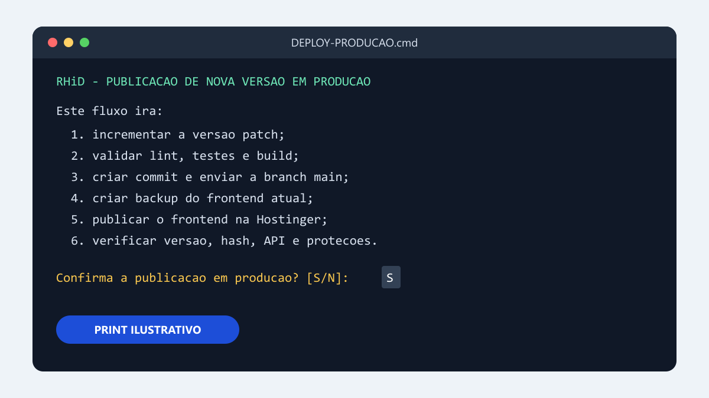
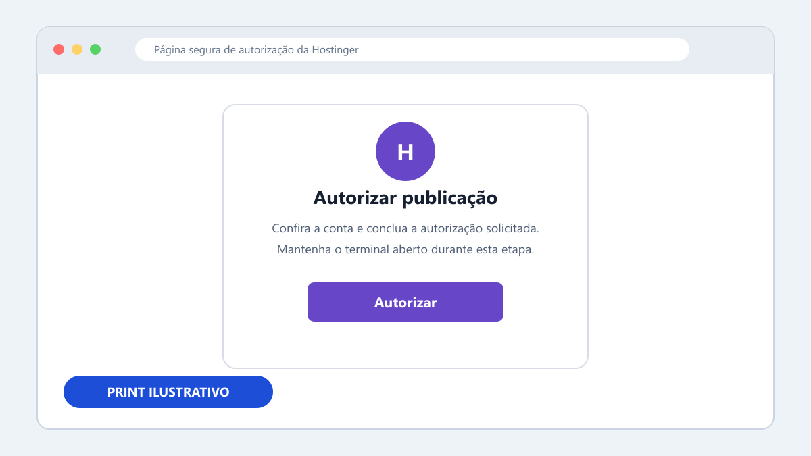
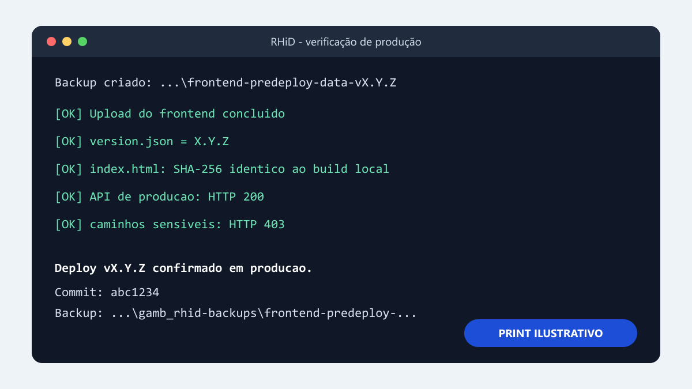

# Manual de versão e deploy em produção

Este manual descreve o fluxo protegido do frontend RHiD em `https://gamberine.com.br/gambrhid/`.

> Atenção: o processo altera a versão, cria commit, envia para `origin/main` e publica em produção. Execute somente quando a alteração estiver aprovada.

## Caminho rápido pelo atalho

1. Feche ou salve os arquivos que estiver editando.
2. Na raiz do projeto, dê dois cliques em `DEPLOY-PRODUCAO.cmd`.
3. Leia o resumo e pressione `S` para confirmar. Pressione `N` para cancelar.
4. Aguarde as validações automáticas. Não feche a janela.
5. Se o navegador abrir a autorização da Hostinger, conclua a autorização.
6. Volte ao terminal e aguarde a mensagem `Deploy vX.Y.Z confirmado em produção.`



## O que o fluxo executa automaticamente

O comando oficial continua sendo `npm.cmd run deploy:force`. O atalho apenas adiciona uma confirmação antes de iniciá-lo.

| Ordem | Etapa automática | Evidência esperada |
|---:|---|---|
| 1 | Confere o uploader local e a versão do Node indicada em `.nvmrc` | Node `22.16.0` |
| 2 | Exige a branch `main`, executa `git fetch` e compara o Git local com `origin/main` | Os dois commits precisam ser iguais |
| 3 | Incrementa a versão patch, por exemplo `0.2.4` para `0.2.5` | `package.json` e `package-lock.json` atualizados |
| 4 | Executa lint, testes, typecheck e build de produção | Todos os comandos terminam com código zero |
| 5 | Verifica o diff e bloqueia segredos, dados locais, dependências e pacotes indevidos | Nenhum arquivo proibido no índice Git |
| 6 | Cria o commit da versão e envia `main` ao Git remoto | Commit `chore: publicar versao X.Y.Z` |
| 7 | Baixa e registra um backup do frontend publicado | Pasta irmã `gamb_rhid-backups` com manifesto |
| 8 | Envia somente o conteúdo de `dist` para a Hostinger | Upload concluído pelo uploader local |
| 9 | Compara o hash do `index.html`, a versão pública, a saúde da API e as proteções | Hash e versão iguais, API `200`, caminhos sensíveis `403` |

O deploy é somente do frontend. Ele não envia banco SQLite, arquivos `.env`, dados locais, dependências ou código-fonte do projeto.

## Etapa manual: autorização da Hostinger

Esta é a única interação manual normal durante o fluxo.

1. Aguarde o navegador abrir a página de autorização.
2. Confira que a autorização corresponde à Hostinger e ao deploy do RHiD.
3. Autorize o acesso solicitado.
4. Não feche o terminal. O upload continua depois que a autorização retorna ao processo.

Se o navegador não abrir, procure no terminal a URL de autorização e abra essa URL no navegador da mesma sessão.



## Confirmação final obrigatória

Considere o deploy concluído somente quando o terminal mostrar as três informações finais:

```text
Deploy vX.Y.Z confirmado em produção.
Commit: <hash>
Backup: <caminho>
```

Além disso, a execução precisa confirmar internamente:

- `version.json` público com a nova versão;
- `index.html` público com o mesmo SHA-256 do build local;
- API de produção respondendo HTTP `200`;
- `.env`, `.data/test`, `package.json` e `session.key` respondendo HTTP `403`.



## Execução manual pelo terminal

Use este caminho se o duplo clique não funcionar.

1. Abra o PowerShell na raiz `D:\ProjetosGit\gamb_rhid`.
2. Confira a versão ativa do Node:

   ```powershell
   node --version
   Get-Content .nvmrc
   ```

3. Se necessário, ative a versão indicada pelo projeto:

   ```powershell
   nvm use 22.16.0
   ```

4. Inicie o mesmo fluxo protegido:

   ```powershell
   npm.cmd run deploy:force
   ```

## Se o processo parar

Leia a última mensagem antes de executar qualquer comando novamente.

### Branch incorreta ou divergência com o remoto

Não force o push e não descarte arquivos. Faça primeiro o diagnóstico:

```powershell
git status --short --branch
git fetch origin main
git rev-parse HEAD
git rev-parse origin/main
```

Resolva conscientemente a divergência antes de reiniciar o deploy.

### Falha antes do commit e do push

Corrija o erro informado, confirme o estado com `git status` e só então reinicie o fluxo. Observe que a versão pode já ter sido incrementada localmente.

### Falha depois do commit ou do push

Não execute `npm.cmd run deploy:force` novamente, pois isso incrementaria outra versão. Confirme primeiro:

```powershell
git status --short --branch
git log -1 --oneline
```

Se a falha ocorreu apenas na autorização ou no upload da Hostinger e o build `dist` continua intacto, retome somente o uploader:

```powershell
node .deploy-upload-static.mjs
```

Depois, faça a verificação pública descrita abaixo. Se houver dúvida sobre a etapa que falhou, interrompa e revise o log antes de publicar.

### Verificação pública manual

```powershell
$temporaryIndex = Join-Path ([IO.Path]::GetTempPath()) 'gambrhid-index-manual.html'
Invoke-WebRequest -UseBasicParsing -Uri 'https://gamberine.com.br/gambrhid/index.html' -Headers @{ 'Cache-Control' = 'no-cache' } -OutFile $temporaryIndex

(Get-FileHash -Algorithm SHA256 -LiteralPath 'dist\index.html').Hash
(Get-FileHash -Algorithm SHA256 -LiteralPath $temporaryIndex).Hash

Invoke-RestMethod -Uri 'https://gamberine.com.br/gambrhid/version.json' -Headers @{ 'Cache-Control' = 'no-cache' }
Invoke-RestMethod -Uri 'https://gambrhid-api.gamberine.com.br/api/health'

foreach ($sensitivePath in '.env', '.data/test', 'package.json', 'session.key') {
  try {
    $status = (Invoke-WebRequest -UseBasicParsing -Uri "https://gamberine.com.br/gambrhid/$sensitivePath").StatusCode
  } catch {
    $status = [int]$_.Exception.Response.StatusCode
  }
  "$sensitivePath -> HTTP $status"
}

Remove-Item -LiteralPath $temporaryIndex -Force
```

Os dois hashes precisam ser idênticos. A versão deve ser a nova versão publicada, a API deve responder normalmente e os quatro caminhos sensíveis devem retornar `403`.

### Processo de desenvolvimento bloqueando arquivos

Se aparecer erro de arquivo em uso, pare normalmente o servidor de desenvolvimento com `Ctrl+C`, confirme que ele encerrou e tente de novo. Não finalize processos desconhecidos à força.

## Registro após a publicação

Guarde no registro da entrega:

- versão publicada;
- hash curto do commit;
- caminho do backup;
- resultado do hash do `index.html`;
- status da API;
- resultado das proteções `403`;
- link e resultado da execução de CI, verificados separadamente.

Commit, push, upload e produção pública são evidências diferentes. A publicação só está confirmada depois das verificações públicas.

## Sobre os prints

Os prints deste manual são ilustrações do fluxo real. Textos e posições da tela de autorização podem mudar na Hostinger, mas a sequência operacional permanece a mesma.
